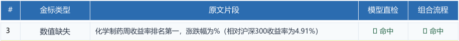

[返回案例索引](../README.md) · [阅读完整正文](../研报数值错误_12例深度Case分析报告_可编辑.md)

## M01  “涨跌幅为%（…”：括号紧邻空百分号的解析缺口

**类别：** 数值缺失 
**来源：** 群文件原文 p.3；金标原表 p.4 第3行（PDF物理页码） 
**样本：** 000614，医药生物行业周报：ASCO催化创新药投资热情，内需复苏&自主可控条线或值得重视 
**源文件行号：** 614（从1开始） 
**金标ID：** `fined:eval_data:5ffe80ef7c529d19:000614:error:0003` 
**正文偏移：** [121, 157)（左闭右开）。

**本例问题：** 百分号前缺少绝对涨跌幅，括号中另有“相对沪深300收益率为4.91%”。两个数值槽不能混用。

### 原文与原表

> 化学制药周收益率排名第一，涨跌幅为%（相对沪深300收益率为4.91%）

### 证据推导

- **锁定空槽：** “涨跌幅为%”明确要求一个数值，但百分号前没有数字。
- **区分指标：** 括号内 4.91% 是相对沪深300收益率，不是该空槽的绝对涨跌幅，不能原样拿来补空。
- **区分类别：** 这里缺的是数字，非名称或缩写；应与同文“美国临床肿瘤学会（）”的属性值缺失分开。

### 历史检测与业务判断

PDF 中该金标两路均命中。它适合当作简单但必要的正例：业务缺口清晰，却能暴露当前规则的标点覆盖差异。

按金标和原文语法均支持数值缺失。虽然同文存在其他收益率，只有在基准、期间、相对收益定义全部明确时才可另作推导，不能自动回填。

**修订建议与前提：** 补齐经来源核对的绝对涨跌幅。当前证据只确认存在空值，不提供未经核验的具体百分比。

### 最新版代码定位

最新版 _PERCENT_GAP_RE 的百分号后置条件包含部分标点、空格和结尾，未包含本例紧邻的全角左括号。P01 已验证：原形“%（”不触发；只改为“%；”后，触发 verified.percent_gap。

- `text_review.py:83`：`_PERCENT_GAP_RE =`
- `text_review.py:486`：`def _numeric_gap_rules`

**已经验证：** 原始数字空槽与 P01 的标点差异均已复核。历史命中不能用来推定当前规则一定命中。

**根因假设，尚待验证：** 本例历史成功可能由模型补足了规则覆盖。探针没有重跑当时模型，因此不据此判断历史根因。

### 最小实验设计（尚未实施）

1. **补齐边界字符：** 对全角/半角括号、冒号、换行和句末逐一检查，并保持数字前置条件。
2. **保留正常表达：** 同时测试“涨跌幅为0%”“同比-0.5%”“单位：万元、%”和“百分之五”，避免误把合法单位说明当缺值。
3. **保持原文位置：** 空槽定位后引用包含共同指标的原句；不要清洗标点后直接复用旧偏移。

### 建议验收条件

- 原例及左右括号变体应识别为数值缺失；正常零值、负值和单位说明不新增误报。
- 引用需完整覆盖金标，且不得将括号内相对收益率填入绝对收益率槽。

**讨论落点：** 把标点变化作为独立边界集，比单测一个“%”字符串更能说明规则是否稳健。
