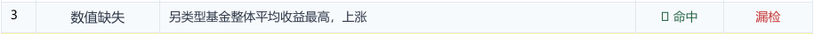

# 研报数值错误：12例深度Case分析报告

整理日期：2026-10-15。状态：供团队逐案讨论与后续人工签核。

对任务的理解：从已提供的真实测评样本抽取少量典型实例，覆盖数值单位错误、数值缺失、数值不一致错误、计算错误，每类3例。逐例给出原文、证据、历史检测现象、当前代码边界及可验证方案。测评记录不等于已核验券商原始发表稿。

版本：已成功拉取GitHub main，完整提交 `a3a37752c8e7c34ec2f38cab04d6afbb25a27a2e`。历史命中状态只依据群PDF；当前只运行离线规则和4组解析探针，未运行模型。原始记录与金标定位12/12通过。

抽样结果：在这12个定向选择的金标实例中，历史直检命中9个，组合命中7个；不可外推全量性能。

|编号|类别|样本|直检|组合|PDF报告起页|
|---|---|---|---|---|---|
|U01|数值单位错误|000625|命中|命中|4|
|U02|数值单位错误|000673|漏检|漏检|6|
|U03|数值单位错误|000691|命中|命中|8|
|M01|数值缺失|000614|命中|命中|10|
|M02|数值缺失|000625|命中|漏检|12|
|M03|数值缺失|000689|命中|漏检|14|
|I01|数值不一致错误|000640|漏检|漏检|16|
|I02|数值不一致错误|000623|命中|命中|18|
|I03|数值不一致错误|000614|命中|命中|20|
|C01|计算错误|000618|命中|命中|22|
|C02|计算错误|000631|漏检|漏检|24|
|C03|计算错误|000682|命中|命中|26|

## U01  同文同值，摘要与正文使用了不同币种单位

**类别：** 数值单位错误 
**来源：** 群文件原文 p.13；金标原表 p.14 第3行（PDF物理页码） 
**样本：** 000625，原油周报：OPEC+连续3月激进增产，油价承压下滑 
**源文件行号：** 625（从1开始） 
**金标ID：** `fined:eval_data:5ffe80ef7c529d19:000625:error:0003` 
**正文偏移：** [195, 223)（左闭右开）。

**本例问题：** 摘要写“万元/桶”，正文对相同日期、相同油种和相同数值写“美元/桶”。存在可在文内复核的单位冲突。

### 原文与原表

> 布伦特、WTI油价分别为62.78、60.79万元/桶。

### 证据推导

- **对齐对象：** 摘要列出布伦特 62.78、WTI 60.79；正文分别再次列出这两个数值，时点均为 2025 年 5 月 30 日当周。
- **对齐单位：** 摘要共用“万元/桶”；正文分别为“62.78美元/桶”“60.79美元/桶”。币种和数量级标签不一致。
- **判定边界：** 原文内部足以发现冲突。两处陈述均存在时，不需要先查询外部油价才能发出核查提示。

### 历史检测与业务判断

群里 PDF 将直检第 1 条、组合第 3 条的“数值单位错误”都判为命中。该例作为成功对照，展示解释应指向两处明确证据，而非仅写“油价不合理”。

按金标为两路命中；业务上也有明确的同文单位冲突。它不是单纯的“62.78 与 60.79 不同”，因为两个值对应不同油种。

**修订建议与前提：** 若以正文的同日同油种报价为依据，摘要单位应统一为“美元/桶”。这是文内对齐建议；本文没有重新核验实际市场报价。

### 最新版代码定位

最新版在该完整文档的离线规则检查中没有输出本例的单位错误。现有文本规则的比率/币种冲突检查与表格 EPS 单位检查，都不能替代叙述性商品报价的跨段对齐。

- `text_review.py:59`：`_RATIO_CURRENCY_RE =`
- `table_unit_context.py:98`：`def eps_unit_comparisons`

**已经验证：** 同文可对齐的数值、单位和日期均已核验；最新版离线规则没有覆盖该目标实例。

**根因假设，尚待验证：** 本例历史命中可能来自模型语义比较。只有历史 PDF，无法确定当时哪一条提示或规则促成命中。

### 最小实验设计（尚未实施）

1. **建立对齐键：** 把“油种 + 指标 + 日期/期间 + 报价口径”作为比较键，同时保存两处原句。
2. **比较单位：** 先保留币种，再拆分倍率及每桶分母。只有对齐键一致才比较单位；禁止直接把人民币与美元当等价标签。
3. **构造对照：** 同日同油种均写美元应不报；不同油种、不同日期或期货/现货口径不同，应分开处理。

### 建议验收条件

- 错误摘要必须能关联正文两条报价，输出“数值单位错误”及全部必要原文位置。
- 正常同单位复述不新增误报；不得把布伦特与 WTI 两个不同值当成数值矛盾。

**讨论落点：** 把文内一致性写成有对象、时间和口径约束的比较，比单靠价格常识更容易复核。

## U02  35亿元/万吨：先完成换算，再讨论单位与数值边界

**类别：** 数值单位错误 
**来源：** 群文件原文 p.53；金标原表 p.53 第1行（PDF物理页码） 
**样本：** 000673，多晶硅行业：价格继续探底，后续下行空间有限 
**源文件行号：** 673（从1开始） 
**金标ID：** `fined:eval_data:5ffe80ef7c529d19:000673:error:0001` 
**正文偏移：** [243, 256)（左闭右开）。

**本例问题：** 金标为单位错误，两路都在同段报了“数值不一致错误”。严格评分均未命中；业务上仍须先核验复合单位。

### 原文与原表

> 实际成交价约35亿元/万吨

### 证据推导

- **精确换算：** 35亿元 / 万吨 = 350000元/吨 = 35万元/吨。复合单位在量纲上成立，不能把“亿”和“万”直接抵消成 3.5万元/吨。
- **邻近参照：** 同文列出 n 型复投料 3.60-3.80万元/吨、n 型颗粒硅 3.40-3.50万元/吨。这与换算后的 35万元/吨相差约一个数量级，但商品等级和数据来源仍需对齐。
- **有限结论：** 这些信息支持重点复核报价，却不能唯一证明究竟是“35”错误、分子倍率错误，还是分母单位错误。

### 历史检测与业务判断

PDF 中直检第 4 条和组合第 5 条均为“数值不一致错误”，且均记为误报；金标第 1 行“数值单位错误”均为漏检。类型不一致已足以阻止严格命中，完整预测跨度还需原始 JSON 才能核对。

评分层面存在错类候选与目标漏检。业务层面，候选提示了同一交易段的异常，不能将其理解为模型完全没看见问题；也不能因金标写单位错误就直接编造修正值。

**修订建议与前提：** 保留“待核验报价及单位”的结论。3.5万元/吨只能作为需原始报价支持的候选表达，不能写成已确认修正。

### 最新版代码定位

最新版离线规则没有输出本例目标错误。现有表格单位辅助主要针对 EPS 等限定结构，没有对这句叙述性“亿元/万吨”产生可复核的换算证据。

- `table_unit_context.py:98`：`def eps_unit_comparisons`
- `text_review.py:59`：`_RATIO_CURRENCY_RE =`

**已经验证：** 复合单位换算为 35万元/吨，且 PDF 两路错类事实成立。换算本身不证明真实报价有误。

**根因假设，尚待验证：** 模型可能把数量级差异归入数值不一致，而没有展示单位换算；PDF 没有完整理由，尚不能认定这是唯一根因。

### 最小实验设计（尚未实施）

1. **输出换算中间量：** 要求提取 value=35、分子币种/倍率、分母质量/倍率，记录统一到元/吨的结果。
2. **单独裁定类别：** 同对象同期间有明确单位冲突时才支持单位类；仅有不同品类报价差异时保留核查状态。不要为追金标直接改标签。
3. **等价与边界对照：** 验证 35亿元/万吨 与 35万元/吨 等价；验证 3.5亿元/万吨 与 3.5万元/吨 等价。另用不同等级、不同日期报价检查误报。

### 建议验收条件

- 所有换算必须可重算，币种、分母和倍率不得丢失。
- 对原例分别记录“按金标匹配”和“业务是否已证实”；缺少报价来源时保持待复核，不自动回填数字。

**讨论落点：** 优先解决可解释的单位标准化，再做类别裁定；不要用机械改标签掩盖证据不足。

## U03  派息率为73元：比率指标与金额单位不相容

**类别：** 数值单位错误 
**来源：** 群文件原文 p.65；金标原表 p.66 第1行（PDF物理页码） 
**样本：** 000691，通信行业双周报：多地聚焦无人机相关低空经济建设 
**源文件行号：** 691（从1开始） 
**金标ID：** `fined:eval_data:5ffe80ef7c529d19:000691:error:0001` 
**正文偏移：** [527, 548)（左闭右开）。

**本例问题：** “派息率”描述比例，原句却用“元”表达。先区分派息率与每股派息金额，才能提出修订建议。

### 原文与原表

> 中国移动：公司2024年全年派息率为73元

### 证据推导

- **确认指标：** 原句主语为“中国移动”，指标名为“2024年全年派息率”，已明确表达比例口径。
- **确认单位：** 数值 73 后直接接“元”，与比例指标的量纲冲突。若指标本想表达每股股息，则连指标名也需核对。
- **避免过修：** 保留 73 并换成百分号只是按现有指标名作的最小修订方向；真实派息率仍应核对公司披露。

### 历史检测与业务判断

金标为“数值单位错误”，PDF 的直检和组合均命中。该例可作为比率类名称扩展的成功样本，但历史命中不等于当前所有比率名称已被规则覆盖。

量纲冲突可从原文判断。不能把“派息率”“股息率”“每股派息”当作同义词，也不应将 73元机械换算成某个百分比。

**修订建议与前提：** 建议核对原始披露后，在“派息率为73%”与“每股派息为某金额”两种解释中确认正确口径；当前只确认指标和单位不相容。

### 最新版代码定位

最新版的 _RATIO_CURRENCY_RE 覆盖毛利率、净利率、资产负债率和市盈率，没有列出派息率。已执行 P03：原句不触发；把指标名改成“毛利率”后，触发 verified.unit_dimension。

- `text_review.py:59`：`_RATIO_CURRENCY_RE =`

**已经验证：** P03 证明这个词表边界影响当前离线规则。它是独立的解析探针，改写后的句子不是新增真实案例。

**根因假设，尚待验证：** 历史两路可能依赖模型对“派息率”的理解。不能用当前词表缺口解释历史模型的全部行为。

### 最小实验设计（尚未实施）

1. **建立指标语义表：** 将派息率、股息率等比例指标与每股派息、股息金额等金额指标分开定义。
2. **按类型校验单位：** 只在指标语义明确时检查单位，避免简单看到“率”就一律套百分号；市盈率应单独允许“倍”。
3. **负向对照：** “每股派息73元”“派息率73%”“市盈率8倍”作为合法表达对照；“派息率73元”作为异常表达。

### 建议验收条件

- 原例应能输出单位冲突及对应指标名；正常的每股金额与倍数表达不报。
- 报告只建议核对口径，不把未经验证的公司真实派息率写成事实。

**讨论落点：** 扩充词表时连同指标类型和合法单位一起维护，防止覆盖增加而误报同步增加。

## M01  “涨跌幅为%（…”：括号紧邻空百分号的解析缺口

**类别：** 数值缺失 
**来源：** 群文件原文 p.3；金标原表 p.4 第3行（PDF物理页码） 
**样本：** 000614，医药生物行业周报：ASCO催化创新药投资热情，内需复苏&自主可控条线或值得重视 
**源文件行号：** 614（从1开始） 
**金标ID：** `fined:eval_data:5ffe80ef7c529d19:000614:error:0003` 
**正文偏移：** [121, 157)（左闭右开）。

**本例问题：** 百分号前缺少绝对涨跌幅，括号中另有“相对沪深300收益率为4.91%”。两个数值槽不能混用。

### 原文与原表

> 化学制药周收益率排名第一，涨跌幅为%（相对沪深300收益率为4.91%）

### 证据推导

- **锁定空槽：** “涨跌幅为%”明确要求一个数值，但百分号前没有数字。
- **区分指标：** 括号内 4.91% 是相对沪深300收益率，不是该空槽的绝对涨跌幅，不能原样拿来补空。
- **区分类别：** 这里缺的是数字，非名称或缩写；应与同文“美国临床肿瘤学会（）”的属性值缺失分开。

### 历史检测与业务判断

PDF 中该金标两路均命中。它适合当作简单但必要的正例：业务缺口清晰，却能暴露当前规则的标点覆盖差异。

按金标和原文语法均支持数值缺失。虽然同文存在其他收益率，只有在基准、期间、相对收益定义全部明确时才可另作推导，不能自动回填。

**修订建议与前提：** 补齐经来源核对的绝对涨跌幅。当前证据只确认存在空值，不提供未经核验的具体百分比。

### 最新版代码定位

最新版 _PERCENT_GAP_RE 的百分号后置条件包含部分标点、空格和结尾，未包含本例紧邻的全角左括号。P01 已验证：原形“%（”不触发；只改为“%；”后，触发 verified.percent_gap。

- `text_review.py:83`：`_PERCENT_GAP_RE =`
- `text_review.py:486`：`def _numeric_gap_rules`

**已经验证：** 原始数字空槽与 P01 的标点差异均已复核。历史命中不能用来推定当前规则一定命中。

**根因假设，尚待验证：** 本例历史成功可能由模型补足了规则覆盖。探针没有重跑当时模型，因此不据此判断历史根因。

### 最小实验设计（尚未实施）

1. **补齐边界字符：** 对全角/半角括号、冒号、换行和句末逐一检查，并保持数字前置条件。
2. **保留正常表达：** 同时测试“涨跌幅为0%”“同比-0.5%”“单位：万元、%”和“百分之五”，避免误把合法单位说明当缺值。
3. **保持原文位置：** 空槽定位后引用包含共同指标的原句；不要清洗标点后直接复用旧偏移。

### 建议验收条件

- 原例及左右括号变体应识别为数值缺失；正常零值、负值和单位说明不新增误报。
- 引用需完整覆盖金标，且不得将括号内相对收益率填入绝对收益率槽。

**讨论落点：** 把标点变化作为独立边界集，比单测一个“%”字符串更能说明规则是否稳健。

## M02  四个库存项目，中间一个数值槽为空

**类别：** 数值缺失 
**来源：** 群文件原文 p.13；金标原表 p.14 第5行（PDF物理页码） 
**样本：** 000625，原油周报：OPEC+连续3月激进增产，油价承压下滑 
**源文件行号：** 625（从1开始） 
**金标ID：** `fined:eval_data:5ffe80ef7c529d19:000625:error:0005` 
**正文偏移：** [1008, 1037)（左闭右开）。

**本例问题：** 直检找到数值缺失，组合改成金融要素缺失。空槽有明确项目位置，可用结构计数和类型边界复核。

### 原文与原表

> 分别为22308.1、1496.3、  、4271.6万桶

### 证据推导

- **对象序列：** 原文依次列出美国汽油总体、车用汽油、柴油、航空煤油，共 4 个库存项目。
- **数值槽序列：** 分别为 22308.1、1496.3、空槽、4271.6万桶。分隔符保留了第 3 槽，不能只丢空后当作 3 个数值重新配对。
- **缺失对象：** 在原文“分别”对应关系下，空的是柴油库存数值。后文给出变化量和变化率，但舍入后的变化信息不能唯一恢复精确库存。

### 历史检测与业务判断

金标第5行显示直检命中、组合漏检。直检第5条报告数值缺失；组合第2条则在同一库存段报告金融要素缺失，被判为误报。这表明同一缺口存在类别竞争。

有明确项目和显式空数值槽，应归数值缺失。组合的同段告警有业务提示价值，但按严格类型匹配仍形成目标 FN 和一个错类候选。不得据此假定整体召回一定更差。

**修订建议与前提：** 核对并补回柴油库存的原始数值；保留其余三项及完整对应关系。禁止把后一个值左移，或使用变化率反推一个看似精确的答案。

### 最新版代码定位

当前完整文档的离线结果在这个区间输出“金融要素缺失 / needs_review”，没有目标数值缺失。_SUSPENDED_PUNCT_RE 覆盖顿号后的悬空标点，而 _numeric_gap_rules 没覆盖这个列表内部的空数值槽。

- `text_review.py:80`：`_SUSPENDED_PUNCT_RE =`
- `text_review.py:436`：`def _suspended_punctuation_rules`
- `text_review.py:486`：`def _numeric_gap_rules`
- `text_fusion.py:17`：`_MISSING_TYPES =`

**已经验证：** 当前规则在同一空槽附近仍产生金融要素缺失候选，这一类别竞争可离线重现。

**根因假设，尚待验证：** 历史组合可能受规则标签、候选融合或模型分类影响。没有原始候选和处理轨迹，不能直接写成“去重吞掉了正确结果”。

### 最小实验设计（尚未实施）

1. **先保留空槽：** 将封闭“对象列表 + 分别 + 数值列表”结构解析为有位置的槽数组，禁止过滤空字符串。
2. **按缺陷对象分类：** 对象已齐全且只有一个数值槽为空时，优先输出数值缺失；对象本身断裂或整项缺失，另作要素/属性判断。
3. **检查融合轨迹：** 重跑时保存规则候选、模型候选、合并前后类型和淘汰原因。只按同一缺陷槽去重，不按整段文本去重。

### 建议验收条件

- 原例保留第 3 槽并给出数值缺失，完整引用包含“分别”及列表；其他独立错误仍保留。
- 四项均完整、合法的 0 值及允许省略的开放列举不报；空槽不得自动补为 0。

**讨论落点：** 优先讨论这一例：结构位置明确，且能同时检验缺值识别、分类与融合三个环节。

## M03  “收益最高，上涨，其次…”：无单位空槽与段内多问题

**类别：** 数值缺失 
**来源：** 群文件原文 p.63；金标原表 p.64 第3行（PDF物理页码） 
**样本：** 000689，开放式基金策略双周报：医药生物主题基金表现领跑市场 
**源文件行号：** 689（从1开始） 
**金标ID：** `fined:eval_data:5ffe80ef7c529d19:000689:error:0003` 
**正文偏移：** [338, 354)（左闭右开）。

**本例问题：** 金标认为“上涨”后的收益幅度缺失，直检命中、组合未保留该类。业务上应先确认这句话是否必须给出数字。

### 原文与原表

> 另类型基金整体平均收益最高，上涨

### 证据推导

- **上下文线索：** 句子处于基金市场回顾，先比较各基金类别平均收益，再写“整体平均收益最高，上涨，其次是QDII基金”。语法上出现数值缺口的可能性较高。
- **证据限度：** 原文没有留下百分号或其他强制数值槽。单写“上涨”在一般行文中可以成立，金标判断与业务确认应分开记录。
- **另一独立缺口：** 同一段还有“美国临床肿瘤学会（）”的空名称槽。它与收益幅度缺失不是同一问题，不能只留一个段级标签。

### 历史检测与业务判断

直检同时给出数值缺失和属性值缺失，并均被 PDF 认可；组合仅保留同段属性值缺失和另一处数值不一致，没有数值缺失。金标第 3 行因此从直检命中变成组合漏检。

按本批金标为组合漏检。业务结论暂定“疑似缺少收益幅度，需核对原稿或模板”；不把所有“上涨，”都判成错误。

**修订建议与前提：** 若原稿确有数字则恢复原值；若原意仅作定性比较，需由人工确认是否保留金标判断。当前不补写涨幅。

### 最新版代码定位

最新版离线结果没有该区间的数值缺失。现有数字空槽规则依赖百分号、序数或单位等显式标记，对没有单位的动词后缺值采取较窄覆盖。

- `text_review.py:486`：`def _numeric_gap_rules`
- `text_review.py:92`：`_FOCUS_GUIDANCE =`
- `text_fusion.py:581`：`def merge_represented_candidates`

**已经验证：** PDF 可以证明组合少了目标类型，但不能证明是哪一步删除候选。当前规则也不能自动证明这一语义缺口。

**根因假设，尚待验证：** 可能是模型未报、段级去重、类别裁决或更保守的缺失边界。需结合原始候选及对应源稿区分。

### 最小实验设计（尚未实施）

1. **先核对预期：** 取得对应源稿或明确写作模板，确认此处原本是否应提供幅度；记录证据来源和最终裁定。
2. **拆开两个问题：** 分别记录收益幅度槽与空名称槽，观察模型和组合能否并存两个独立 findings。
3. **合法定性对照：** 用“收益上涨，排名居前”“价格上涨，需求改善”等表达检查过报；仅有动词和逗号时不作自动确认。

### 建议验收条件

- 若来源确认缺值，组合应保留数值缺失及空名称两个实例；若来源不足，保留待复核理由。
- 合法定性表述不新增确认误报；不得为贴合金标随意填数字或强制改类。

**讨论落点：** 这一例适合讨论业务边界和多问题保留，不适合直接补一条“上涨后无数字”的硬规则。

## I01  31个子行业里排名第41：同句异常没有落入正确类别

**类别：** 数值不一致错误 
**来源：** 群文件原文 p.24；金标原表 p.24 第1行（PDF物理页码） 
**样本：** 000640，医药日报：施维雅收购BioNova在研新药BN104，用于治疗白血病 
**源文件行号：** 640（从1开始） 
**金标ID：** `fined:eval_data:5ffe80ef7c529d19:000640:error:0001` 
**正文偏移：** [75, 109)（左闭右开）。

**本例问题：** 第 41 名超过同句明示的 31 个子行业。两路在该市场表现句中有告警，却都没命中数值不一致金标。

### 原文与原表

> 跑输沪深300指数0.32pct，涨跌幅居申万31个子行业第41名。

### 证据推导

- **限定集合：** 原文“涨跌幅居申万31个子行业第41名”明确把名次限制在同一个子行业集合内。
- **检验约束：** 合法顺序名次应满足 1 <= rank <= 31；41 > 31，局部数值关系不成立。
- **保留其他问题：** 同句另有“涨跌幅-0.40亿元”的单位冲突。发现单位问题不能替代名次越界，两个实例应独立报告。

### 历史检测与业务判断

PDF 中两路均报该句的“数值单位错误”和“语义逻辑矛盾”。前者命中另一单位金标，后者被判误报；目标“数值不一致错误”在两路均漏检。

业务上存在可直接验证的排名约束冲突。严格评分失败可能包含分类因素；不能由同句有告警推出该排名错误已被正确识别。

**修订建议与前提：** 核对真实排名或集合总数。41 显然不适配现有 31 的集合，但不能自动把 41 改成 14、21 或其他数字。

### 最新版代码定位

当前 rank_exceeds_explicit_total 未识别本句。P02 已验证：改成受支持的“31个一级行业中排名第41名”会触发 verified.rank_within_total，原句不触发。原形含“子行业”和“居…第…名”，超出现有句式。

- `text_structure.py:36`：`_RANK_WITH_TOTAL =`
- `text_structure.py:111`：`def rank_exceeds_explicit_total`
- `text_review.py:460`：`def _structured_relation_rules`

**已经验证：** 原文中的 41 > 31 与 P02 的句式边界均成立；当前规则覆盖不足有直接证据。

**根因假设，尚待验证：** 历史候选可能以语义逻辑矛盾解释了排名异常，也可能解释了同句其他问题。PDF 理由不全，不能确定错误解释是否完全一致。

### 最小实验设计（尚未实施）

1. **扩展受约束句式：** 支持“居…N个子行业第R名”“在N个一级子行业指数中涨跌幅排名第R位”，同时保留集合限定词。
2. **同句多实例：** 按“指标单位”和“集合名次”分别建立证据及问题键，核查合并前后两者是否保留。
3. **边界对照：** 测试 N 内排名、并列排名和不同排名集合；不把“31个行业参评，位居全国第41名”混成同一集合。

### 建议验收条件

- 原例同时保留单位错误与排名数值不一致，位置和类别分别成立。
- N 内排名不报；集合不一致或无明确总数时不自动确认越界。

**讨论落点：** 本例适合以结构化排名规则补覆盖，再单独评估模型分类和候选融合。

## I02  4个国家、5个金额、4个同比：保持“分别”的一一对应

**类别：** 数值不一致错误 
**来源：** 群文件原文 p.12；金标原表 p.12 第1行（PDF物理页码） 
**样本：** 000623，电力设备行业跟踪报告：逆变器出口：4月出口高增长，亚非欧市场表现稳健 
**源文件行号：** 623（从1开始） 
**金标ID：** `fined:eval_data:5ffe80ef7c529d19:000623:error:0001` 
**正文偏移：** [628, 681)（左闭右开）。

**本例问题：** “分别”建立一一对应关系，但对象、金额和同比三列的长度为 4 / 5 / 4。无需加总即可证明序列不一致。

### 原文与原表

> 我国对沙特、阿联酋、印度、巴基斯坦逆变器出口金额分别为0.33、0.12、1.66、2.73、3.58亿元

### 证据推导

- **对象计数：** 沙特、阿联酋、印度、巴基斯坦，共 4 个国家。
- **金额计数：** 0.33、0.12、1.66、2.73、3.58亿元，共 5 个金额；单位在列表末尾共用。
- **增长率计数：** 后接 -91.39%、+133.17%、+0.86%、+2.99%，共 4 个同比。三列长度不一致，无法直接逐项配对。

### 历史检测与业务判断

群里 PDF 对直检第 3 条、组合第 3 条的数值不一致均判命中。该例是封闭并列计数的成功对照。

这是序列对应不一致，不是“这些国家金额加起来是否等于亚洲总额”的计算错误。国家可能只是地区子集，未明确穷尽时不能强行要求与地区总额相等。

**修订建议与前提：** 核对是否漏列第 5 个国家，或多写了某一金额。现有证据不能唯一确定应删除 3.58，也不能自行补一个国家名。

### 最新版代码定位

最新版 paired_series 未识别该序列。当前窄解析要求每个金额分别带单位，且同比连接词顺序有限；本例金额共用末尾单位、连接词为“分别同比”，与已支持结构不同。

- `text_structure.py:19`：`_PAIRED_SERIES =`
- `text_structure.py:87`：`def paired_series`
- `text_review.py:460`：`def _structured_relation_rules`

**已经验证：** 四国、五金额、四同比可人工复数，且当前结构解析没有产生对应记录。

**根因假设，尚待验证：** 历史成功可能来自模型对“分别”的理解；不能据此认为最新确定性规则也能覆盖共享单位列表。

### 最小实验设计（尚未实施）

1. **解析完整序列：** 在同句明确的“对象 + 分别 + 值”关系内保留对象列表、共享单位和每个数值，不截取便利前缀。
2. **支持共享单位：** 对“0.33、0.12亿元”与“0.33亿元、0.12亿元”验证等价；同时支持“分别同比”和“同比分别”的有界表达。
3. **限制适用范围：** 开放例举、含“等”的非穷尽名单、不同期间多组数据应先分组，不因任意两个数字列表长度不同而报错。

### 建议验收条件

- 原例给出 4 / 5 / 4 的中间计数和完整原文，类别为数值不一致。
- 对齐后的 4 / 4 / 4 正常对照不报；不得推定多余金额身份或强行做地区合计。

**讨论落点：** 把“分别”当作一一对应约束，同时保留共享单位，是此类规则最有价值的边界。

## I03  31个一级子行业里第35：用成功样本对照漏检

**类别：** 数值不一致错误 
**来源：** 群文件原文 p.3；金标原表 p.4 第1行（PDF物理页码） 
**样本：** 000614，医药生物行业周报：ASCO催化创新药投资热情，内需复苏&自主可控条线或值得重视 
**源文件行号：** 614（从1开始） 
**金标ID：** `fined:eval_data:5ffe80ef7c529d19:000614:error:0001` 
**正文偏移：** [92, 113)（左闭右开）。

**本例问题：** 与 I01 同属排名越界，但本例两路均命中。它用于区分任务能力、表述变化与具体流程行为。

### 原文与原表

> 在31个一级子行业指数中涨跌幅排名第35位

### 证据推导

- **同一约束：** “在31个一级子行业指数中涨跌幅排名第35位”给出总数 31 和排名 35，满足直接比较条件。
- **确定异常：** 35 > 31，且原句没有切换到全国、全部股票或其他外层集合，排名与集合不相容。
- **比较价值：** I01 为 31 与 41、两路漏检；本例为 31 与 35、两路命中。两个样本表述与上下文同时不同，不能当严格因果对照。

### 历史检测与业务判断

PDF 两路对本例数值不一致均判命中。同一份文档的 M01 缺值也被两路命中，可验证同段存在多个独立错误时系统有能力给出多个标签。

本例业务判断与金标一致。它只能说明这一具体记录成功，不能证明换一个行业、名次或写法都能稳定成功。

**修订建议与前提：** 核对真实名次或集合总数；仅凭越界关系无法给出正确排名。

### 最新版代码定位

当前离线结构解析对原句返回空。_RANK_WITH_TOTAL 接受限定的“行业中 + 排名/位居/位列/排行 + 第”结构，不覆盖本例“子行业指数中涨跌幅排名”的原始写法。

- `text_structure.py:36`：`_RANK_WITH_TOTAL =`
- `text_structure.py:111`：`def rank_exceeds_explicit_total`

**已经验证：** 本例历史命中与当前原句规则未触发分别成立；二者属于不同执行条件，不能直接称为版本退化。

**根因假设，尚待验证：** I01/I03 差异可能来自句式、同句其他异常、模型输出类别或随机性。没有保持其他条件一致的重跑，不能选定单一原因。

### 最小实验设计（尚未实施）

1. **保持内容只改一项：** 分别固定行业和句式，只交换 35 / 41；再固定数字，只交换两种排名句式。每项保留错误和合法名次。
2. **做正常边界：** 使用排名第 31、排名第 1、并列第 31，以及排名第 32；明确验证上下边界。
3. **评估两层稳定性：** 先离线看结构化证据；若运行模型，再固定模型、提示和参数，保存每次原始输出与类型。

### 建议验收条件

- I01 和 I03 两种原始句式均能输出总数、排名与一致的类别。
- 成功对照不得因扩展新句式而丢失；报告需分别展示原句与改写结果。

**讨论落点：** 保留成功案例是为了检验修复能否稳定泛化，避免只追着单个漏检句补特例。

## C01  58.76减54.9应为3.86，原文却写减少5.8

**类别：** 计算错误 
**来源：** 群文件原文 p.7；金标原表 p.7 第1行（PDF物理页码） 
**样本：** 000618，金属与材料行业研究周报：基本金属震荡上行，小金属分化关注权益机会 
**源文件行号：** 618（从1开始） 
**金标ID：** `fined:eval_data:5ffe80ef7c529d19:000618:error:0001` 
**正文偏移：** [712, 759)（左闭右开）。

**本例问题：** 同一段给出本周、上周库存和减少量，三者不能同时成立；差异远大于显示精度允许的舍入误差。

### 原文与原表

> 中国方面，本周铝锭社会库存持续减少，目前库存54.9万吨，较上周58.76万吨减少5.8万吨。

### 证据推导

- **绑定操作数：** 对象为中国铝锭社会库存：上周 58.76万吨，本周 54.9万吨，原文声称减少 5.8万吨。
- **复算差值：** 58.76 - 54.9 = 3.86万吨；与声称减少量相差 1.94万吨。前一句 LME 库存属于另一对象，不能混入计算。
- **考虑舍入：** 按末位四舍五入，差值可落在约 3.805-3.915万吨；原文 5.8 对应约 5.75-5.85万吨，区间不重叠。

### 历史检测与业务判断

金标为计算错误，群里 PDF 的直检和组合都命中。该例是可用文内三元关系完成验证的成功样本。

确定的是三元关系冲突，而不是已经知道其中哪一项原始库存错误。数值类型、对象和单位相同，适合归计算错误。

**修订建议与前提：** 如果上周与本周库存值均正确，减少量应为约3.86万吨。若库存值本身有误，应回到来源修订，不能只改计算结果。

### 最新版代码定位

最新版离线未输出目标计算错误，算术辅助也没有覆盖该“目前库存…较上周…减少…”结构。P04 将同一数字关系写成显式算式后触发 verified.arithmetic，说明隐式三元关系与显式算式的覆盖不同。

- `text_review.py:55`：`_EQUATION_RE =`
- `arithmetic_context.py:27`：`_INVENTORY_CHANGE =`
- `arithmetic_context.py:372`：`def source_arithmetic_checks`

**已经验证：** 差值与舍入区间已计算；P04 证明当前显式算式规则能识别同样的数字冲突。

**根因假设，尚待验证：** 历史成功可能由模型完成隐式关系推断。不能因有显式算式规则，就声称历史系统对所有自然语言减法都有覆盖。

### 最小实验设计（尚未实施）

1. **绑定三元关系：** 限定同对象、同库存口径和相邻期间，抽取 prior / current / delta 与方向，再检查 prior-current=delta。
2. **附带显示精度：** 以各数值最后显示位建立区间，区间不相容才给出确定性算术证据。
3. **隔离相邻对象：** 保留原文 LME 与国内两组数据作为干扰对照，确认不会把不同市场库存拼在一起。

### 建议验收条件

- 能复现 3.86、1.94 和不重叠的舍入区间，并完整引用三元关系。
- 若把减少量改为与精度相容的 3.9万吨，应不再报此计算错误；相邻单位问题独立处理。

**讨论落点：** 先绑定对象、期间和三个数值，再计算；误差阈值应来自显示精度，而非任意百分比。

## C02  1988.9除2503.8约为79.4%，正文写成69.4%

**类别：** 计算错误 
**来源：** 群文件原文 p.19；金标原表 p.19 第1行（PDF物理页码） 
**样本：** 000631，权威发布：2025年4月国内市场手机出货量2503.8万部，其中5G手机占比79.4%。 
**源文件行号：** 631（从1开始） 
**金标ID：** `fined:eval_data:5ffe80ef7c529d19:000631:error:0001` 
**正文偏移：** [60, 146)（左闭右开）。

**本例问题：** 正文比例与同句分子、分母不相容；标题又写79.4%。两路报数值不一致，却没有命中计算错误金标。

### 原文与原表

> 2025 年 4 月，国内市场手机出货量 2503.8 万部，同比增长 4.0%，其中，5G 手机 1988.9 万部，同比下降 1.7%，占同期手机出货量的 69.4%。

### 证据推导

- **确定口径：** 原文为 2025 年 4 月国内市场手机出货量 2503.8万部，其中 5G手机 1988.9万部，占同期出货量 69.4%。对象、期间和单位可对齐。
- **计算比例：** 1988.9 / 2503.8 × 100 = 79.435258…%，按一位小数为 79.4%。考虑分子、分母显示精度，比例约 79.43168-79.43884%，不接近 69.4%。
- **同文辅助对照：** 标题恰写 79.4%，但它属于同一来源，不能当独立外部真值。另一金标“19款 / 50款 = 48.0%”实际应为 38.0%，两路均命中该计算错误。

### 历史检测与业务判断

金标第 1 行两路漏检。两路第 1 条都报“数值不一致错误”，引用片段连接标题和正文，被判误报。PDF 不提供完整原始跨度和理由，不能仅凭片段判定是否还存在锚定失败。

业务上可同时看到标题/正文冲突和正文算术冲突；本任务目标金标要求计算错误。只输出跨段数值不一致，仍不能替代同句算式证据。

**修订建议与前提：** 若手机总量与5G量准确，正文占比应约为79.4%。同时核对相邻的新机型占比，避免只修一处。

### 最新版代码定位

最新版离线没有该目标计算错误；source_arithmetic_checks 也未给出此处比例辅助。现有 rounded_share_checks 明确针对金额/收入，并非万部、款等数量占比的通用解析。

- `arithmetic_context.py:48`：`_SHARE_MONEY =`
- `arithmetic_context.py:270`：`def rounded_share_checks`
- `text_review.py:92`：`_FOCUS_GUIDANCE =`

**已经验证：** 分子、分母、算式及舍入区间均可从同句验证。历史错类候选存在，但其处理来源仍未知。

**根因假设，尚待验证：** 模型可能优先解释标题/正文差异而未保留算术类；引用拼接也可能影响定位。必须看原始候选和评分详情才能区分。

### 最小实验设计（尚未实施）

1. **扩展数量占比：** 支持“总数量 + 其中子数量 + 占同期总数量比例”，绑定同单位、同期间和明确包含关系。
2. **分离两个任务：** 分别生成正文占比复算与标题/正文一致性证据；防止一个跨段类别覆盖局部计算实例。
3. **使用同文对照：** 同时检查 1988.9/2503.8 与 19/50；并以正确的 79.4%、38.0%及合法舍入值作正常对照。

### 建议验收条件

- 原例提供同句算式并按计算错误表达，完整覆盖金标；结果保留显示精度。
- 不混用月度、累计、出货量和新机型款数；正常舍入与标题复述不新增独立误报。

**讨论落点：** 这一例的价值在于把“看到两个比例不同”推进到“明确哪条算术关系不成立”。

## C03  价差增加17.94，环比4.73%的计算依据不成立

**类别：** 计算错误 
**来源：** 群文件原文 p.59；金标原表 p.60 第2行（PDF物理页码） 
**样本：** 000682，大炼化周报：节前备货需求偏弱，炼化产品价格有所下跌 
**源文件行号：** 682（从1开始） 
**金标ID：** `fined:eval_data:5ffe80ef7c529d19:000682:error:0002` 
**正文偏移：** [92, 137)（左闭右开）。

**本例问题：** 当期值和增加量可推出基期，再计算环比。按原文数据得到约1.676%，与4.73%不相容。

### 原文与原表

> 国外重点大炼化项目价差为1088.33元/吨，环比变化+17.94元/吨（+4.73%）。

### 证据推导

- **还原基期：** 国外重点大炼化项目当期价差 1088.33元/吨，环比增加 17.94元/吨；上期应为 1088.33 - 17.94 = 1070.39元/吨。
- **计算环比：** 17.94 / 1070.39 × 100 = 1.6760246…%，约为 1.68%。原文为 +4.73%，无法同时成立。
- **排除舍入解释：** 考虑两项数值各保留两位小数，可能增长率保守区间约 1.67554-1.67651%；原文4.73%的显示区间约4.725-4.735%，两者不重叠。

### 历史检测与业务判断

PDF在直检和组合中均将该条计算错误判为命中。本例适合核查理由是否给出了基期、计算公式和结果。

冲突可以确定，但哪一项数据应修订仍需来源。不能仅因错误与增长率相关，就把根因直接写成“模型分母用成当期值”。

**修订建议与前提：** 若当期价差和绝对增加量正确，环比应约+1.68%。该建议以两项输入准确为前提。

### 最新版代码定位

最新版离线目标未命中，算术辅助也未覆盖原句。当前 price_change_checks 的词表与连接结构较窄，原文“价差为…环比变化+…（+…%）”与已支持的价格/均价和显式涨跌幅结构不同。

- `arithmetic_context.py:16`：`_CHANGE =`
- `arithmetic_context.py:101`：`def price_change_checks`
- `arithmetic_context.py:372`：`def source_arithmetic_checks`

**已经验证：** 上期 1070.39、增长率约1.676%及舍入区间均已重算；当前解析不覆盖该原形。

**根因假设，尚待验证：** 历史命中可能来自模型在上下文中完成基期还原。不能仅凭命中表确认当时真的使用了正确基期公式。

### 最小实验设计（尚未实施）

1. **扩展指标及连接词：** 在严格关系下支持价差、环比变化及括号中百分比，保留正负号和完整同单位证据。
2. **明确基期公式：** current - signed_change = prior；relative_change = signed_change/prior。基期为0或口径不明时不自动下结论。
3. **覆盖下降与边界：** 测试增加、减少、负号、括号、省略“涨跌幅”以及精度可相容的正确百分比；区分同比与环比。

### 建议验收条件

- 原例输出基期、增长率和精度区间；不能只给没有中间量的错误断言。
- 改为+1.68%应与显示精度相容；百分点变化、不同价差口径及零基期另行处理。

**讨论落点：** 将基期还原、符号和精度统一到证据链，可以复用到库存、价格和其他环比关系。

## 建议执行顺序

|优先级|案例|动作|验收证据|
|---|---|---|---|
|优先 1|M02 / I01|先做列表空数值槽与排名句式的离线规则实验；记录一条原文中多问题的合并轨迹。|原例、正常对照、完整引用、类型与空槽位置；不得丢掉同句独立问题。|
|优先 2|M01 / U03|先补标点与指标词表边界，并为合法括号、零值、金额与倍数表达补负向对照。|扩大覆盖后，合法单位说明、每股金额和市盈率不新增确认误报。|
|优先 3|C01 / C02 / C03|统一操作数绑定及显示精度区间，逐一扩展隐式差值、数量占比、价差环比的解析结构。|每例都能重算；不同对象、期间和单位不串联；舍入可相容时不确认冲突。|
|单独复核|U02 / M03|先拿到对应报价源/原稿或模板，裁定真实问题及分类边界，再决定是否改检测策略。|分别记录评分结论与业务结论；证据不足时不补造数字，不为提分强制改类。|

## 已执行检查与限制

- 对12例核验上游正文、冻结输入、SHA-256、金标精确偏移、群PDF原句及金标类别；全部通过。12例均scorable=true。
- 当前main@a3a3775对10份完整文档运行hybrid、chat=None、examples=()。模型未运行。按类型且完整包含金标span，离线目标匹配0/12；这不代表最新版完整系统的召回，也不能与历史两路命中数直接比较。
- P01百分号括号、P02排名句式、P03派息率词表、P04显式算式，共4对8条解析输入。改写仅为解析探针，不计入真实案例。
- Decimal核算：35亿元/万吨=35万元/吨；58.76-54.9=3.86；1988.9/2503.8*100≈79.435258%；17.94/(1088.33-17.94)*100≈1.676025%。舍入区间见provenance.json。
- 未提供历史批次完整原始模型JSON及处理轨迹，不声称确定历史内部根因；拟议修复和策略实验尚未实施。

## 金标边界示例（不计入主12例）

000643第1条期待的片段含“上涨1.55%”，实际正文相应处为“上涨1.55万平方米”，原始start_idx=-1，冻结金标scorable=false、span_0:unresolved。不要将PDF表中这个“漏检”直接当成可计分FN调参。

## 证据文件

`evidence/cases.json`、`selected_source_records.json`、`pdf_selected_records.json`、`pdf_locations.json`、`images/`、`provenance.json`、`current_offline_results.json`、`parser_probes.json`、`verification.json`。`qa_report.json`记录最终排版与文件检查。

负责人、复核人、讨论后的最终裁定与日期由团队实际填写。
